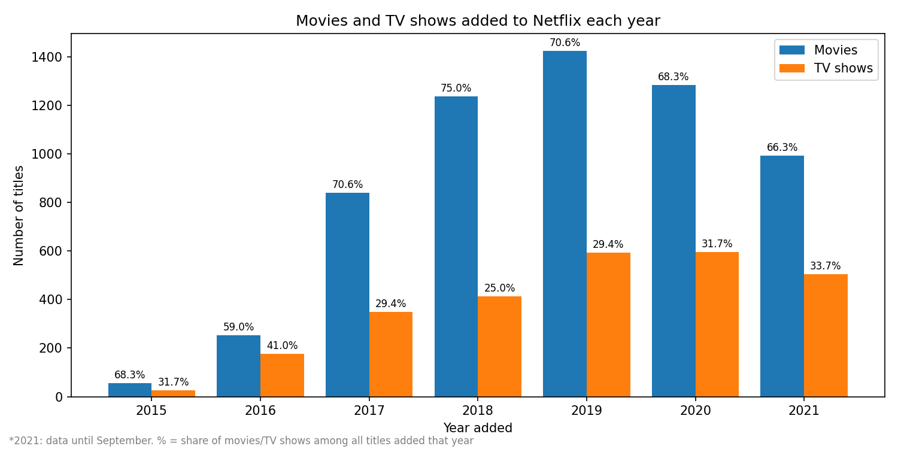
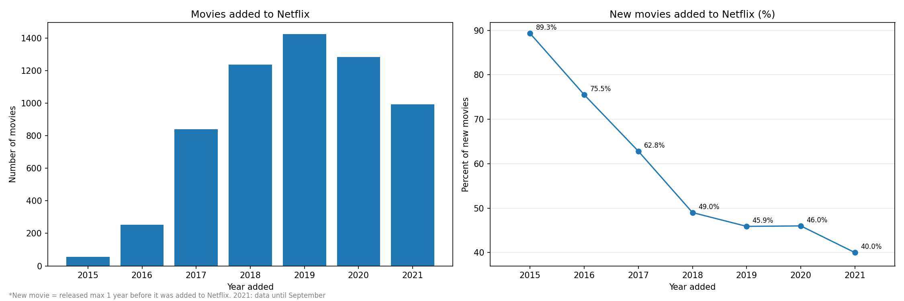
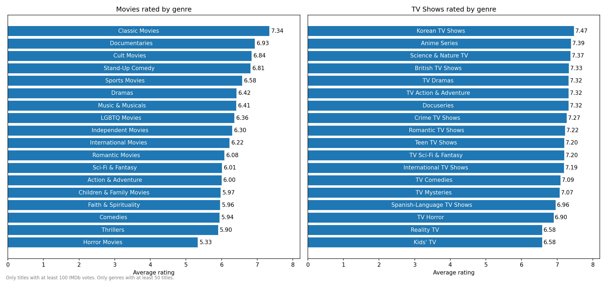
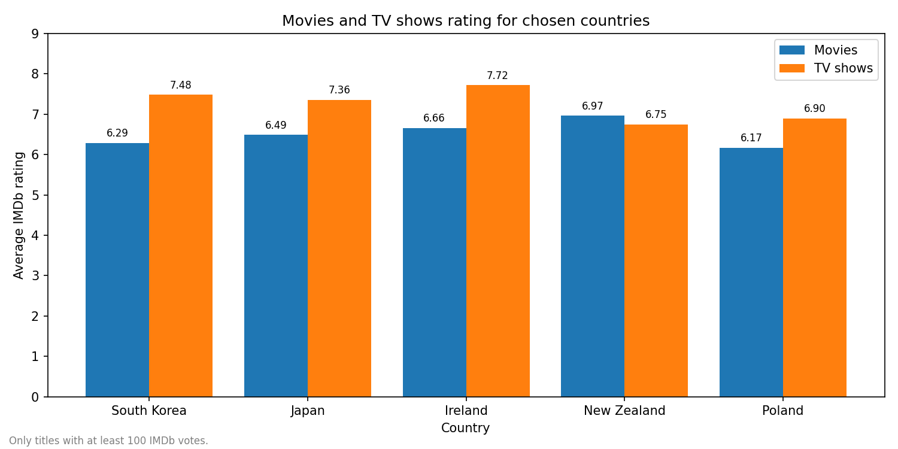
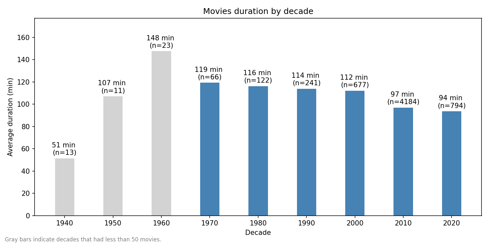
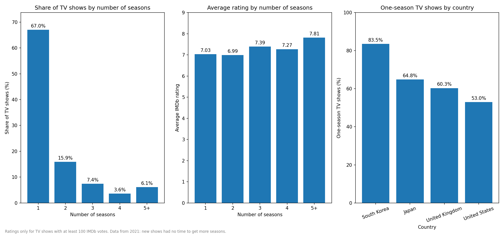

# Netflix × IMDb: What Makes Netflix Content Successful?

In this project I combined the Netflix catalog with IMDb ratings to find out
what Netflix adds to its library and how these titles are rated.
All analysis is done in **SQL (SQLite)**, and the charts are made in **Python (pandas, matplotlib)**.



## Data

- **Netflix Movies and TV Shows** (Kaggle, Shivam Bansal): 8,807 titles available on Netflix in 2021
- **IMDb datasets** (title.basics, title.ratings): titles, years, types and ratings

The Netflix data has no IMDb ID, so the biggest part of the project was matching the two datasets.

## How I matched Netflix with IMDb

I matched titles by name, year and type, and improved the rules step by step:

| Step | Matched titles |
|---|---|
| Exact match on title + year + type | 66.6% |
| Different year rules for movies (max 2 years) and TV shows (any earlier start year) | 77.4% |
| Normalized titles (lower case, no special characters) + original titles | **85.6%** |

Some problems I found on the way:
- For TV shows Netflix gives the year of the latest season, but IMDb gives the year the show started.
- Many titles have the same name as other movies, so I had to choose the right one.
  I took the one with exactly the same title first, and then the one with the most votes.
- Short films in IMDb were matched with full-length Netflix movies, so I only allowed them for short movies.

## What I found

**1. More TV shows since 2018.** Movies are always the majority, but the share of TV shows
grows every year since 2018 (from 25% to 33.7% in 2021).

**2. Netflix adds more and more older movies.** In 2015, 89% of added movies were new.
In 2021 only 40%.



**3. TV shows get higher ratings than movies.** The best rated movie genres are Classic Movies,
Documentaries and Stand-Up Comedy. Horror movies are the worst. For TV shows Korean TV Shows and Anime are at the top.



**4. South Korea and Japan have the best rated titles**, but mostly because of their TV shows.
Poland is 31st of 40 countries.



**5. Movies are getting shorter:** from 119 minutes in the 1970s to 94 minutes in the 2020s.



**6. 67% of TV shows have only 1 season**, but shows with more seasons are rated higher.
Korean dramas are usually planned as one season, so Korea has the most one-season shows (83.5%).



## Limitations

- The data is from 2021 and shows only titles that were still on Netflix then.
- 14.4% of Netflix titles could not be matched with IMDb.
- For ratings I only used titles with at least 100 votes, because ratings from a few votes are not reliable.

## Project structure

```
├── scripts/load_data.py         # loads CSV and IMDb files into SQLite
├── sql/01_exploration.sql       # first look at the data
├── sql/02_imdb_matching.sql     # matching Netflix with IMDb
├── sql/03_cleaning.sql          # cleaning and the final tables
├── sql/04_analysis.sql          # analysis questions
├── notebooks/analysis.ipynb     # charts
└── images/                      # charts used in this README
```

## How to run it

1. Download the [Netflix dataset](https://www.kaggle.com/datasets/shivamb/netflix-shows)
   and the IMDb files `title.basics.tsv.gz` and `title.ratings.tsv.gz` from [IMDb datasets](https://datasets.imdbws.com/) into `data/`
2. `pip install -r requirements.txt`
3. `python scripts/load_data.py`
4. Run the SQL files in order (01 → 04)
5. Open `notebooks/analysis.ipynb` for the charts

IMDb data is used for non-commercial purposes, according to IMDb's terms.